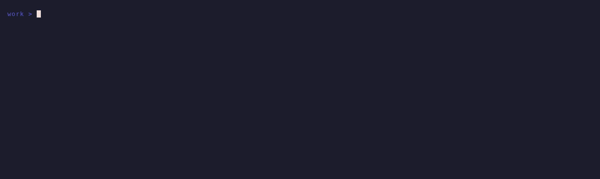

# sheaf



sheaf manages a group of git repositories checked out side by side in one
directory, the *bundle*. Each repository gets a fixed layout: a primary
checkout in a directory named after the default branch, and linked worktrees
(`git worktree`) as its siblings, one directory per branch, tag or pull
request. sheaf clones repositories from GitHub (one by one or by
organization), adopts existing clones, and runs bundle-wide operations
(status, fetch, fast-forward update, running a command everywhere, pruning
merged worktrees, syncing with organizations). It runs as an interactive TUI
on a terminal and as a plain CLI otherwise.

Worktrees are not recorded in `sheaf.yaml`: git (`git worktree list`) is the
source of truth, so worktrees created or removed with plain git are picked up.

## Contents

- [Install](#install)
- [Concepts](#concepts)
- [Quick start](#quick-start)
- [The home screen](#the-home-screen)
- [Command reference](#command-reference)
- [Shell integration](#shell-integration)
- [Safety model](#safety-model)
- [TUI and plain mode](#tui-and-plain-mode)
- [JSON output](#json-output)
- [Platform support](#platform-support)
- [Development](#development)
- [License](#license)

## Install

Requirements:

- Go 1.27 or later to build (`go.mod`).
- git 2.36 or later (`sheaf doctor` checks this; other commands do not).
  Tested with git 2.47 and 2.56.
- [`gh`](https://cli.github.com/), authenticated with `gh auth login`, for
  everything that talks to GitHub: `add` (it resolves `owner/repo` through
  gh, including for single repositories), `add --org`, fork detection, `sync`
  and `wt pr`. Commands working on local state (`adopt`, `init`, `status`,
  `fetch`, `update`, `run`, `wt add/list/rm`, `path`, `prune`, `remove`) do
  not need gh; `add`, `sync`, `adopt` and `init` use it, when available, to
  set the gh default repository of new checkouts (see
  [gh default repository](#gh-default-repository)).

With Go installed:

```sh
go install github.com/jponge/sheaf/cmd/sheaf@latest    # or @v0.1.0 for a given release
```

This installs into `$(go env GOBIN)`, or `$(go env GOPATH)/bin` by default,
and `sheaf version` prints the release.

From a clone of this repository:

```sh
make build VERSION=v0.1.0      # writes bin/sheaf, version stamped
make install VERSION=v0.1.0    # installs into $(go env GOBIN) or $(go env GOPATH)/bin
go install ./cmd/sheaf         # same, without stamping
```

`sheaf version` prints the version given through `VERSION=` (that is,
`-ldflags "-X github.com/jponge/sheaf/internal/cli.Version=..."`). Without
one, it prints the version Go recorded in the binary: the module version for
`go install <module>/cmd/sheaf@<version>`, a pseudo-version (commit, `+dirty`
for uncommitted changes) for a build in a git checkout, and otherwise `dev`,
followed by the commit when known.

Then set up the [shell integration](#shell-integration) and run
`sheaf doctor` inside a bundle to check git, gh and the bundle.

## Concepts

### Bundle and `sheaf.yaml`

A bundle is a directory containing a `sheaf.yaml` file. Commands find the
bundle by walking up from the working directory (symbolic links resolved) to
the first directory containing a regular file named `sheaf.yaml`;
`--bundle <dir>` overrides the search.

`sheaf.yaml` (schema version 1) is written by sheaf:

```yaml
version: 1
sources:                       # organizations tracked by `sheaf sync`
  - org: smallrye
    exclude: [legacy-thing]    # declined with `sync --exclude`; no longer proposed
repositories:
  - name: boiler-vroom         # directory name under the bundle
    slug: jponge/boiler-vroom  # the reference repository (owner/name)
    url: git@github.com:jponge/boiler-vroom.git
    default_branch: main
    origin: explicit           # explicit | org:<name> | adopted
    host: gitlab.com           # optional; omitted means github.com, "local" for file:// remotes
    fork:                      # optional; present when origin is your fork
      slug: you/boiler-vroom
      url: git@github.com:you/boiler-vroom.git
```

GitHub features (`sync`, `wt pr`, organization listings) skip repositories
whose host is not `github.com`. For SSH configuration aliases (e.g.
`git@github-work:...`) the alias is recorded as the host unless
`adopt --host github.com` is given.

`.sheaf.lock` next to `sheaf.yaml` is the lock file (flock(2)) serializing
bundle updates between concurrent sheaf processes. It stays on disk by
design; a second process waits for the first.

### Repository layout

```
~/work/                      bundle
├── sheaf.yaml
├── .sheaf.lock
└── boiler-vroom/            repository directory
    ├── main/                primary checkout (named after the default branch)
    ├── feat-cli-rework/     worktree of branch feat/cli/rework
    ├── v1.2.0/              worktree pinned at tag v1.2.0 (detached HEAD)
    └── pr-123/              pull request from a fork (branch pr/123)
```

- **Repository directory** `<bundle>/<repo>/`. Its name is the repository
  name (letters, digits, `.`, `_`, `-`; not starting with `.` or `-`). Two
  repositories with the same name from different owners clash: use
  `add --as <dir>`.
- **Primary checkout** `<bundle>/<repo>/<default-branch>/`. This is a
  regular clone (with its own `.git` directory), and the *directory* is what
  makes it primary: it may have any branch checked out, temporary switches
  are fine. `wt add <default-branch>` is refused, with a hint to switch the
  primary back when it is on another branch.
- **Worktrees** `<bundle>/<repo>/<normalized-branch>/`, created with
  `git worktree add` from the primary. Branch names are normalized to
  directory names: every character outside `[A-Za-z0-9._-]` (including `/`)
  becomes `-`, runs of `-` collapse, leading and trailing `-` and `.` are
  trimmed (`feat/cli/rework` → `feat-cli-rework`). Two branches mapping to
  the same directory (compared case-insensitively) are refused.
- **Tag worktrees** (`wt add --tag v1.2.0`) are detached at the tag's
  commit, in the same directory namespace. `update` never moves them,
  `prune` never removes them.
- **Pull request worktrees** (`wt pr <n>`): a pull request from a branch of
  the repository is checked out like that branch; one from a fork (or whose
  head branch was deleted) goes to `<repo>/pr-<n>/` on the local branch
  `pr/<n>`, tracking `refs/pull/<n>/head`.

### Forks

When you have a fork of a repository you add, sheaf clones it with
`origin` = your fork and `upstream` = the reference repository; the default
branch tracks `upstream/<default>`, new branches start from
`upstream/<default>`, and `sheaf.yaml` keeps the reference slug plus a
`fork` entry. Forks are detected on `add` with one gh listing of your forks
(`--no-fork` disables it) and on `adopt` when a clone has an `upstream`
remote naming another repository whose default branch shares history with
origin's. `adopt --recheck <repo>` records a fork that became visible after
the repository was registered (e.g. after `git fetch upstream`). sheaf never
creates forks. Fetch, update, merged/gone and unpushed checks consider both
remotes.

### gh default repository

In a clone with two GitHub remotes, gh has no default repository and `gh pr
list`, `gh issue list` etc. fail or ask which one to use. So for every GitHub
repository it adds (`add`, `add --org`, `sync`) or adopts (`adopt`, `init
--adopt-all`, `adopt --recheck`), sheaf runs `gh repo set-default <slug>` in
the primary checkout, where `<slug>` is the reference repository: `upstream`
for a fork, `origin` otherwise. gh stores it in the repository's git
configuration (`remote.<name>.gh-resolved`), which the worktrees share.
Repositories of other hosts are left alone.

An existing default is kept. sheaf reads it from the git configuration (no gh
call): when it already is the reference repository nothing happens; when it
is another repository, or several are configured, sheaf leaves it alone and
prints a note (`note: gh default repository of x is me/x (reference: up/x);
kept`). To switch it, run `gh repo set-default <slug>` in the checkout.

This never makes a command fail. The gh calls of a command run one at a
time, even with `-j`. When gh is missing, not logged in or does not answer
within 30 s, sheaf prints one warning for the command and does not run gh for
its other repositories; a failure specific to one repository (for instance no
remote that gh recognises) is a warning for that repository, with the command
to run (`cd <checkout> && gh repo set-default <slug>`).

To set it for repositories already in a bundle (registered by an earlier
sheaf, or while gh was not logged in), run `sheaf adopt --recheck --all`, or
`sheaf adopt --recheck <repo>...` for some of them. Like any recheck, it
also records forks that have become visible, and it keeps existing defaults.

`sheaf doctor` reports, for each GitHub repository, a missing default
(warning, with the command to run), several configured defaults (warning,
with the `git config --unset` commands that leave one) and a default naming
another repository than the reference one (information only).

## Quick start

```sh
sheaf create ~/work && cd ~/work         # new, empty bundle
sheaf add jponge/boiler-vroom            # clone into boiler-vroom/main/
sheaf add --org smallrye                 # TUI: pick repositories from a list
sheaf add --org smallrye --repo smallrye-config --repo smallrye-common  # plain mode
sheaf add --org smallrye --all           # every non-archived repository
```

An existing directory of clones:

```sh
cd ~/src
sheaf init                 # writes sheaf.yaml, lists the clones found (TUI: pick them)
sheaf adopt foo bar        # foo/ (a plain clone) is moved to foo/<default-branch>/
sheaf init --adopt-all     # or adopt everything found in one go
```

`adopt` never checks out or switches anything; linked worktrees of a moved
clone are repaired.

Daily use:

```sh
cd ~/work/boiler-vroom/main
cd "$(sheaf wt add feat/cli/rework)"   # creates ../feat-cli-rework/, prints its path
sheaf status                           # every checkout of the bundle, no network
sheaf update                           # fetch once per repository, then fast-forward
sheaf run --dirty-only git diff --stat
scd boiler-vroom feat-cli-rework       # cd via the shell integration
sheaf wt rm -d feat/cli/rework --yes   # remove the worktree and its merged branch
sheaf prune                            # list worktrees whose branch is gone or merged
```

## The home screen

`sheaf` without a command, inside a bundle, with standard input and output
on a terminal, opens an overview of every checkout of the bundle (columns
REPO, DIR, BRANCH, AGE, STATE). It reads local state only; nothing is fetched
when it opens. Checkouts that cannot be inspected are shown as problem rows.
Rows are grouped by repository (primary first, problem rows last): REPO is
only shown on the first row of each group, and on the first row on screen
when the list is scrolled or filtered (the filter still matches it).
DIR is blank when it is the directory sheaf derives from BRANCH (the
branch or tag normalized as in [Repository layout](#repository-layout),
e.g. `feat-x` for `feat/x`, or `main` for the primary checkout of `main`),
so it shows only directories that differ (the filter still matches them).
In a bundle without repositories, it lists what to run instead, one
command per line: `sheaf add owner/repo`, `sheaf add --org <org>` and, for
clones already in the bundle directory, `sheaf adopt <dir>` (`<dir>` is
relative to the current directory: outside the bundle root, the hint gives
the bundle's path before it).

AGE is the age of the last commit of the checkout (the author date of
HEAD, as `git log` shows it; a rebase keeps it), rounded down: `now` under
a minute, then minutes (`5m`), hours (`3h`), days (`2d`), weeks under 30
days (`4w`), months of 30 days up to `11mo`, then years of 365 days (`1y`
from 360 days, `2y`). It is empty on problem rows, on error rows, for a
branch without commits (unborn) and when the commit cannot be read.
STATE is `clean` or `dirty` (anything not committed, untracked files
included), followed by `↑N ↓M`, the commits to push and to pull relative to
the upstream as of the last fetch (e.g. `clean, ↑2 ↓1`; a zero side is
omitted, nothing is shown when in sync), or by `upstream gone` or
`no upstream`. A pull request worktree whose branch tracks
`refs/pull/<n>/head` (what `wt pr` sets up for a pull request from a fork;
git sees no upstream) shows `PR #<n>` instead, followed by the arrows
relative to the pull request head recorded by the last `wt pr` (e.g.
`clean, PR #7 ↑1`). STATE is coloured by its worst part: red for a divergence
(`↑` and `↓`), `upstream gone`, errors and problem rows; yellow for local
changes or commits to push or pull (`dirty`, `↑`, `↓`); faint for
`no upstream`; green otherwise (clean, in sync or detached). In a narrow
terminal, the wider of DIR and BRANCH is truncated first (with `…`), then
both alike, down to 8 columns each, so that STATE fits;
lines that still do not fit are cut at the right, ending with `…` (as in
every view of the TUI). The title (`sheaf: <bundle>`) and that of the
report view show the home directory as `~`; commands in hints keep
absolute paths, so that they can be pasted.

Below the table, the status line gives the number of rows selected, the
number shown by the filter (`N shown`) and the scroll position (`rows a-b
of n`), then the message: the outcome of the last action, or why a key was
refused. The message wins: `N shown` and the scroll position are left out
when they would cut it, and a message that does not fit after the number
selected wraps to a second line (after the parts that leave it whole),
cut with `…` only beyond it. On a problem
row, the message is the whole problem (the table may cut it), until the
cursor moves or a key gets another answer.

On a terminal (not with `TERM=dumb`), the names of the repositories hosted
on github.com are hyperlinks to their page (for a clone of your fork, the
repository, as `sheaf browse` opens it), and `PR #<n>` in STATE to the pull
request (OSC 8 sequences: most terminals open them with a ctrl- or
cmd-click; others show the text alone). Repositories on other hosts,
including SSH aliases of github.com, have no link.

| Key | Action |
|---|---|
| up/down, k/j, pgup/pgdown, home/end (g/G), mouse wheel | move (the wheel by 3 rows) |
| space | toggle the selection of the current row |
| a, n | select / deselect every visible row (rows hidden by the filter keep their selection) |
| / | filter (case-insensitive substring over the cells; enter keeps it, esc clears it) |
| enter | change directory to the current checkout and exit (see below) |
| y | copy the absolute path of the current checkout to the clipboard; the overview's message says `sent to the clipboard: <path>`. The terminal is asked with an OSC 52 sequence, which some terminals ignore or block by default (inside tmux, it depends on its `set-clipboard` option); not available with `TERM=dumb` |
| u | update the selected rows (or the current row) |
| f | fetch the repositories of the selected rows (or the current row) |
| w | add a worktree to the current row's repository: a prompt asks for a branch (an existing local or remote one, else a new branch from the default branch, as `wt add`), tab switches to a tag. As you type, the first branch or tag in byte order (uppercase before lowercase) that starts with the text (case-sensitively) is suggested, faint after the cursor: local branches and the branches of `origin` (for a clone of your fork, of `origin` and `upstream`), or tags, read from the local refs (nothing is fetched; the prompt does not wait for them). → or ctrl+e accepts the suggestion; enter confirms the text as typed |
| # | check out a pull request of the current row's repository (GitHub only): a prompt asks for its number (`#123` also accepted), then `wt pr` runs |
| b | open the current row on GitHub, as `sheaf browse` run in its directory (the pull request of its branch, else the repository's home page); the outcome is the overview's message (`browse: opened o/r`, `browse failed: ...`), without a report view |
| r | remove the selected worktrees (or the current one); not the primary. Several worktrees are checked as `wt rm` checks each one (each repository fetched once) and confirmed in one dialog listing what will be removed, with the fate of each branch, and the worktrees refused |
| p, d, s | `prune`, `doctor`, `sync` on the whole bundle |
| ? | show every key in the key help, or only the main ones again |
| q, esc | quit with status 0 (esc first clears an applied filter) |
| ctrl+c | exit with status 130 (during an action, cancel the action, see below) |

The key help below the table is one short line (`space toggle • a/n
all/none • enter cd • u update • f fetch • ? more • q quit`, with
`enter path` without the shell function, see below); `?` shows the
full list (with `/`, movement and every action), and the next overviews keep
that choice until `?` is pressed again. The selection menus of the commands
(e.g. `sync`, `init`) work the same way: their short line lists space, `a`,
`n`, enter, `? more` and esc/q, and `?` shows the others (`/`, movement).

To receive the mouse wheel, the overview and the report view turn on the
terminal's mouse reporting (clicks are ignored), which is off again in the
other views and once sheaf ends. While it is on, dragging no longer selects
text: most terminals still select it with a modifier held, usually shift
(option in iTerm2). Not with `TERM=dumb`.

The overview is drawn on the terminal's alternate screen, so each one starts
on a clear screen. Actions run with the TUI of the corresponding command
(progress view, confirmation dialogs, menus, prompt) on the normal screen.
What the action prints (the report of `doctor`, summaries, notes, warnings,
errors) appears there as it runs, as for the command alone, and stays there
as a log you see after quitting or after an interruption. It is then shown
again (except for `b`, whose outcome fits in the overview's message) in a
report view on the alternate screen, titled
`sheaf <action>: <bundle>`, whether the action succeeded, failed or changed
nothing. Lines wider than the terminal wrap, their continuation lines
indented under the text (after the level word or a short label, e.g. `OK`,
`done`, `hint:`; by 2 columns after a path). Up/down (k/j) and the mouse
wheel scroll it, pgup/pgdown (b/space) by a page, home/end (g/G) jump to
the top or the bottom; q, esc or enter returns to the overview (other keys
are ignored), ctrl+c exits with 130. An action cancelled in its
dialog, menu or prompt (enter in the `sync` menu with nothing selected
counts as cancelled) shows no report view, unless it printed something
(e.g. the warnings of `sync` before its menu; progress lines such as
`listing repositories of acme...` do not count). q, esc and enter
pressed during the first quarter second of the view (e.g. typed while
the action ran) are ignored, so the report is not skipped unseen. The
overview then shows the outcome: the counts of the command's summary,
without the zero ones (e.g. `update: 1 fast-forwarded, 1 skipped
(diverged)`, `wt rm: 2 removed, 1 refused`, `prune: 1 removed`,
`sync: 1 added`, `doctor: 2 warnings` or `doctor: all OK`), followed by
`(see report)` when some failed (`sync: 2 added, 1 failed (see report)`),
`prune: nothing to prune` when nothing changed, `add failed: ...`,
`<action>: done` for the others; quitting afterwards still exits with
0. The selection is kept, except after an update, fetch or removal of the
selected rows that succeeded.

Ctrl-C during an action (in its progress view, which says `^C cancel`, its
dialogs, menus or prompt, or while it prints on the normal screen) cancels
the action, not sheaf: its work is interrupted as for the command alone
(see [Interruption](#interruption-ctrl-c)), the report view shows what it
printed (none when it printed nothing, e.g. Ctrl-C in its prompt), then
the overview comes back with `<action>: interrupted` (e.g.
`fetch: interrupted`) and the selection kept. A second Ctrl-C during the
same action is the emergency stop, which ends sheaf with 130. Ctrl-C in
the overview or the report view exits with 130.

Enter writes the checkout's path to the file named by `SHEAF_CD_FILE`, which
the `sheaf` shell function defined by `sheaf shell-init` creates and then
`cd`s into. Without the shell function the path is printed alone on
standard output, and a hint on standard error gives the line that adds
the shell function to the startup file of the shell of `$SHELL` (bash,
zsh or fish); the key help then says `enter path` rather than
`enter cd`. sheaf removes `SHEAF_CD_FILE` from its environment at startup, so
the processes it starts (git, hooks, `sheaf run` commands) never see it.

Outside a bundle (no `sheaf.yaml` in the working directory or a parent),
bare `sheaf`, with a terminal or not, prints four lines and exits with 0:

```
sheaf: not in a bundle: no sheaf.yaml found in /home/me/src or any parent directory
hint: create one with `sheaf create [dir]`
hint: or adopt existing checkouts with `sheaf init [dir]`
hint: `sheaf --help` lists the commands
```

A command that needs a bundle fails there, or with a `--bundle` directory
without `sheaf.yaml`, with its error and the same two `hint: ...create
one` / `...adopt` lines on standard error (`doctor` runs anyway and gives
its own hint). Inside a bundle, with `--no-tui` or without
a terminal, bare `sheaf` prints the help.

## Command reference

Global flags:

- `--bundle <dir>`: bundle directory (default: nearest parent containing
  `sheaf.yaml`).
- `--no-tui`: plain CLI mode.
- `-j, --jobs <n>`: repositories processed in parallel (checkouts for
  `status` and `run`); default: the number of CPUs.

Each entry lists the main flags only; `sheaf <command> --help` documents
every flag and the exact semantics.

Arguments naming a repository are exact, case-sensitive repository names
(directory names); a name that only differs by case gets a "did you mean"
hint. `--repo` filters of `status`, `fetch`, `update`, `run` and `prune`
also accept glob patterns (`--repo 'smallrye-*'`, repeatable).

### Bundle

**`sheaf create [dir]`**: create a new, empty bundle (default: the current
directory).

**`sheaf init [dir]`**: create `sheaf.yaml` in an existing directory and list
the checkouts found in its subdirectories: plain clones, and repositories
with a single checkout `<dir>/<child>/`. `--adopt-all` adopts them; in TUI
mode a menu lets you pick, and the checkouts left out are listed with the
`sheaf adopt` command to adopt them later.

**`sheaf doctor`**: check git (2.36 or later), gh installation and
authentication for github.com, `sheaf.yaml`, and for each repository its
directory, primary checkout, remote URLs (and fork setup), the
[gh default repository](#gh-default-repository) (GitHub repositories),
missing or outside worktrees, and lock files left in its git directory. Directories of
the bundle that are not registered are listed. Nothing is fetched or
changed. One line per check (OK, INFO, WARN, FAIL); exit status 1 when a
check fails. `--json`.

**`sheaf version`**: print the version.

### Repositories

**`sheaf add <owner/repo>...`** / **`sheaf add --org <org> (--all | --repo <name>...)`**:
clone into `<bundle>/<repo>/<default-branch>/` and record in `sheaf.yaml`.
Repositories already in the bundle are skipped. With `--org`, the
organization (or user) becomes a tracked source for `sync` (sheaf says so
when it starts tracking it, even when every chosen repository was already
present); archived repositories need `--include-archived`; without
`--all`/`--repo`, TUI mode shows a selection menu (repositories already in
the bundle are shown, not selectable, and counted apart) and plain mode
lists the candidates and fails.
`--as <dir>` names the directory (single repository). `--no-fork` disables
fork detection. Each clone gets its
[gh default repository](#gh-default-repository).

**`sheaf adopt <dir>...`**: register existing checkouts located directly in
the bundle. A plain clone `<dir>/` is moved to `<dir>/<default-branch>/`; a
single checkout `<dir>/<child>/` is renamed to it if needed. Owner, name and
host come from the `origin` URL. `--default-branch` when it cannot be
determined, `--host` to record a host instead of an SSH alias, `--recheck`
to re-examine the remotes of already registered repositories and record a
fork (nothing is moved; a recorded fork is never dropped or changed);
`--recheck --all` re-examines every registered repository. Adopting and
rechecking also set the [gh default repository](#gh-default-repository).

**`sheaf remove <repo>`**: fetch, check every checkout and worktree for data
that would be lost, then delete the worktrees, the repository directory and
its `sheaf.yaml` entry. Requires `--yes` in plain mode; TUI mode shows the
plan in a confirmation dialog (skipped with `--yes`). `--force`,
`--offline`. See [Safety model](#safety-model).

**`sheaf sync`**: list the repositories of each tracked organization
(`--org` restricts) and compare with the bundle: `new`, `gone`, `moved`
(informational) and `archived` (informational). Only github.com repositories
are compared. Without action flags nothing changes. Actions, applied in this
order: `--exclude [org/]name` records declined repositories in `sheaf.yaml`,
`--add-new` clones the remaining new ones, `--remove-gone --yes` removes the
gone ones with the checks of `sheaf remove` (`--force`,
`--allow-mass-removal`). In TUI mode without action flags, a menu offers the
new and gone repositories (nothing preselected; gone ones refused as a mass
removal are shown but not selectable), then asks to confirm removals; the
TUI never applies `--force` or `--allow-mass-removal`. New
repositories left unselected are not excluded: the next sync proposes them
again (decline them for good with `--exclude`). `--json` prints the
proposals without changing anything. Exit status 1 when gone candidates could not be looked up.

### Checkouts and worktrees

`worktree` has the alias `wt`. For `wt add`, `wt rm` and `path`: with two
arguments the first is the repository; with one argument, inside a checkout
of the bundle it names a branch or directory of that checkout's repository,
outside any checkout it is a repository name.

**`sheaf status`**: branch, upstream, ahead/behind, staged, unstaged,
untracked, conflicted counts and stashes of every checkout, primary first.
No network access: ahead/behind are relative to the last fetch, unless
`--fetch`. `--repo`, `--primary-only`, `--dirty-only`, `--json`. Checkouts
that cannot be inspected are listed as problems after the table and make
the exit status 1. When standard input and output are both terminals
(without `--no-tui` or `--json`) and the terminal is narrower than that
table, status prints the compact table of the home screen instead: REPO,
DIR, BRANCH, CHANGES and STATE (`clean, ↑1 ↓2`, `dirty, no upstream`,
`clean, PR #7`...), with CHANGES made of the non-zero counts `+` staged,
`~` unstaged, `?` untracked, `!` conflicted and `$` stashes (e.g. `+2 ~1
?3`). Its columns give way (with `…`) before STATE does, and its lines,
problems included, are cut to the terminal's width. With standard input
or output not a terminal (e.g. `echo | sheaf status`), `--no-tui` or
`--json`, status always prints the full output.

**`sheaf fetch`**: `git fetch --prune origin` once per repository (for a fork:
`upstream`, then `origin`), repositories in parallel. `--repo`.

**`sheaf update`**: fetch once per repository, then fast-forward each checkout
(primary first) to its upstream with `git merge --ff-only`. Only checked-out
branches move. A checkout is skipped, with the reason, when it has staged or
unstaged changes (untracked files do not count), is detached, has no
upstream or a deleted one, or has diverged. Tag worktrees are reported as
pinned. Exit status 1 when a checkout failed or could not be inspected;
`--strict` also counts skips. `--repo`, `--primary-only`. Interruption: see
[Ctrl-C](#interruption-ctrl-c).

**`sheaf run [flags] [--] <command> [args...]`**: run a command in each
checkout directory, several at a time (`-j`). The output of each is printed
as one block headed `==> repo/dir <==`, in checkout order; with `-j 1` it is
streamed live. The command runs without a shell unless `--shell` (the first
argument is then a script for `sh -c`, the others its `$1`, `$2`, ...).
Flags after the command name belong to the command. The command gets no
standard input and no controlling terminal; `SHEAF_REPO`, `SHEAF_DIR` and
`SHEAF_BRANCH` describe the checkout. Exit status 1 if any command failed.
`--repo`, `--primary-only`, `--dirty-only`.

**`sheaf wt add [<repo>] <branch>`**: create `<repo>/<normalized-branch>/` for
the local branch if it exists, else a local branch tracking
`origin/<branch>`, else a new branch from `--base` (default
`origin/<default>`, `upstream/<default>` for a fork). The remotes are fetched
first unless `--no-fetch` (alias `--offline`). A name that is only a tag is
refused: use `--tag`. The path is printed on standard output, progress on
standard error:

```sh
cd "$(sheaf wt add feat/x)"
```

**`sheaf wt add [<repo>] --tag <tag>`**: detached worktree at the tag's
commit, pinned to the tag. Local tags are never deleted or overwritten.

**`sheaf wt list [<repo>]`** (alias `ls`): every checkout with its directory,
branch, flags (primary, off-default, detached, tag, locked, prunable,
outside) and path. `outside` marks a worktree that is not a direct child of
the repository directory `<bundle>/<repo>/` (by its path or its resolved
path): elsewhere, but also deeper inside it (e.g. `<repo>/group/x`).
`--porcelain` prints paths only (`-z`: NUL-terminated), `--json`. Unusable
worktrees (another repository's, or without `.git`) are reported and make
the exit status 1.

**`sheaf wt remove [<repo>] [<branch-or-dir>]`** (alias `rm`, used in this
document): remove a linked worktree, named by branch, tag or directory
(`--branch`/`--dir` when a name is both). `-d` also deletes the local branch
if merged, `-D` even if unmerged; when `-d` finds the branch unmerged, the
whole removal is refused (the worktree is kept too; use `-D`, or drop `-d`
to keep the branch). Without `-d`/`-D` the branch is kept; the plan says
whether it is deleted or kept. Requires `--yes` in plain mode; TUI mode
asks in a dialog.
`--force`, `--offline`. The primary checkout cannot be removed (use
`sheaf remove`).

**`sheaf wt pr [<repo>] <number>`**: check out a GitHub pull request (`#123`
also accepted) in a worktree and print its path. Running it again for a
pull request from a fork fast-forwards its worktree to the current head,
refusing uncommitted changes and force-pushed heads. `sheaf update` skips
these worktrees; `git pull` works in them.

**`sheaf path [<repo>] [<branch-or-dir>]`**: print the bundle root, a
repository's primary checkout, or a worktree (also by tag). Inside a
checkout, one argument names a worktree of that repository if there is one,
else a repository; `--repo`, `--dir`, `--branch` disambiguate.

**`sheaf browse [<repo>]`**: open a page of a GitHub repository in the web
browser with gh (installed and logged in): without argument, the repository
of the checkout containing the working directory, else the named repository
(its primary checkout). For a clone of your fork the page is on the
repository (`upstream`); `--fork` opens the home page of your fork
(`origin`). The page is:

- in a worktree of a pull request from a fork checked out by `wt pr`
  (branch `pr/<number>`, tracking `refs/pull/<number>/head` of the
  repository): the pull request (`gh pr view <number> --repo <slug> --web`);
- for a branch tracking another branch of the repository or of your fork,
  except the repository's default branch: the pull request of that branch, which gh looks
  up (`gh pr view <branch> --repo <slug> --web`, `<fork owner>:<branch>` for
  a branch of your fork); when there is none, the home page (the message
  says `(no pull request for branch ...)`);
- otherwise (default branch, no upstream, detached, tag): the home page
  (`gh repo view <slug> --web`).

`--branch` opens the tree of the branch the checkout's branch tracks, under
its remote name, on the repository of its upstream remote
(`branch.<name>.remote`: the repository or your fork; a separate push remote
is not considered): `gh browse --repo <slug> --branch <branch>`. It is
refused for a branch without upstream (push it first), one tracking a pull
request, one tracking a remote sheaf does not know, and with `--fork`.
Repositories of other hosts are refused.

### Maintenance

**`sheaf prune`**: fetch (unless `--offline`), then find the linked worktrees
whose branch is gone (upstream deleted on the remote) or merged into
`origin/<default>` (`upstream/<default>` for a fork) with a merge commit.
Squash- and rebase-merged branches are found only once their remote branch
is deleted. Without `--yes` it only lists the candidates (dry run); with
`--yes` each is removed like `sheaf wt rm`. `--delete-branches` also deletes
the branches of removed worktrees when merged (like `-d`, never `-D`);
`--include-branches` also deletes gone or merged local branches without a
worktree. `--repo`, `--json`. In TUI mode the candidates are shown in a
confirmation dialog, which states what will be removed and whether each
worktree's branch is kept or, with `--delete-branches`, deleted (a branch
is deleted only if merged, as `git branch -d`).

### Shell

**`sheaf shell-init bash|zsh|fish`**: print the `sheaf` and `scd` shell
functions. **`sheaf completion bash|zsh|fish`**: print the completion script.
See [Shell integration](#shell-integration).

## Shell integration

### `sheaf` and `scd` functions

```sh
# ~/.bashrc or ~/.zshrc
eval "$(sheaf shell-init bash)"    # or zsh
```

```fish
# ~/.config/fish/config.fish
sheaf shell-init fish | source
```

This defines:

- `scd [<args>]`: `cd` to the output of `sheaf path <args>`. `scd` alone goes
  to the bundle root, `scd <repo>` to the primary checkout,
  `scd <repo> <branch-or-dir>` to a worktree. When `sheaf path` fails, its
  status is returned and the directory is unchanged. `scd` completes like
  `sheaf path` and does not need `sheaf completion`.
- `sheaf`: a wrapper that runs the sheaf binary and, after enter on a
  checkout in the [home screen](#the-home-screen), changes the directory to
  it. Every other use behaves as without the function (same arguments,
  streams and exit status).

The fish functions need fish 3.1 or later. zsh completion of `scd` needs
`compinit` to have run before.

Known limits of bash `scd` completion: completing inside an open single
quote a candidate that itself contains a single quote, words quoted as
`$'…'`, and `!` inside double quotes (history expansion) are not handled.
Complete such names without quotes, or type them in full.

### Completion

```sh
source <(sheaf completion bash)       # needs the bash-completion package
source <(sheaf completion zsh)        # after compinit
sheaf completion fish | source
```

`sheaf completion <shell> --help` shows how to install the script
permanently. Besides commands and flags, completion offers repository
names, worktree branches and directories, branches for `wt add`, and
organizations, read from the bundle (`--bundle` on the command line is
honoured). It never uses the network.

## Safety model

sheaf deletes data in `remove`, `wt rm`, `prune` and `sync --remove-gone`.
These commands share one set of rules.

**Confirmation.** In plain mode, nothing is deleted without `--yes`
(`remove`, `wt rm`, `sync --remove-gone`); `prune` without `--yes` is a dry
run. sheaf never prompts in plain mode: missing input is an error. In TUI
mode, a dialog shows what will be deleted and asks for confirmation unless
`--yes` is given. The hints of refusals and of `prune` give the complete
command to run (e.g. with `--force`, `-D` or `--offline`). When `remove`,
`wt rm` or `prune` was run with `--yes` in plain mode, the hints that run
the refused removal again with `--force` or `-D`, the `wt rm` hint of a
worktree that `prune` kept, and the `prune --include-branches` hint include
`--yes`, so that they run as printed; such a hint always names the bundle
with `--bundle <root>`, so that pasted in another bundle it still acts on
this one. So do the other hints that carry `--yes`: the "needs
confirmation" hints of `remove` and `wt rm` in plain mode, the dry-run
hint of `prune`, and the `sync --remove-gone --yes` hints of `sync`. Every
other hint leaves `--yes` out, so that the pasted command asks for
confirmation (a dialog in TUI mode, a hint with `--yes` in plain mode), and
names the bundle only when `--bundle` was given. That is the
case in TUI mode, without `--yes`, and always for the `--offline` hints
(offline, the stale remote-tracking refs that the failed fetch could not
refresh count, so the plan must be confirmed again), the hints about pull
request worktrees that `prune` skips (and about tag worktrees, in its
`--json` skips), the `sheaf remove` hints of
`sync --remove-gone` (its `--yes` confirms removing gone repositories, not
forcing past their risks) and the `sheaf remove` that `wt rm` suggests for
a primary checkout.

**Fetch first.** `remove`, `wt rm` and `prune` fetch before deciding, so
that commits whose remote branch was deleted count as unpushed. `--offline`
skips the fetch and decides on the remote-tracking refs of the last fetch
(possibly stale). For a fork, when your fork is gone or with `--offline`,
its remote-tracking refs are not trusted (not pushed, not a merge target).
Only the remotes sheaf fetches count: `origin` (`upstream` and your fork for
a fork). sheaf never fetches other remotes, so their remote-tracking refs
may be stale (a branch deleted there, a remote that no longer exists) and
are never trusted, with or without `--offline`: commits only on them count
as unpushed (push to `origin`, or use `--force` or `-D`). Of a trusted
remote, only the refs its fetch writes and prunes count: the destinations
of its fetch refspecs (`remote.<name>.fetch`, by default
`refs/remotes/<name>/*`, as configured in the primary checkout, where sheaf
fetches), not the refs of other remotes inside them (e.g. of a remote named
`origin/x`); a remote with a negative refspec (`^...`) is not trusted at
all. In a nested repository, which is fetched with `git fetch --all`, the
same applies to the remotes that command fetches (not those with
`remote.<name>.skipFetchAll`, nor those whose URL, after `insteadOf`
rewriting, is inside the deleted tree), also with `--offline`. The refusals about unpushed branches
(`remove`) and unmerged branches (`wt rm -d`, `prune --delete-branches`)
name the untrusted refs that hold the commits; the others (detached HEAD,
nested repositories) do not. `sync` does not accept `--offline`.

**Data at risk** (refused unless `--force`):

- `remove`: uncommitted changes, untracked files, stashes, unpushed commits
  in any checkout or worktree; entries of the repository directory that
  belong to no checkout (OS files such as `.DS_Store` excepted); nested
  repositories (also inside ignored directories) that are dirty, have
  stashes, unpushed commits or no remote, or whose fetch failed (their
  remote state is unknown); a remote repository that no longer exists.
  Commits reachable from a pull request head recorded by `wt pr` count as
  pushed (with `--offline`, as of its last fetch).
- `wt rm`: uncommitted changes, untracked files, commits only on a detached
  HEAD in that worktree.
- `sync --remove-gone`: as `remove`; in addition, a gone repository whose
  remote still answers (a likely gh token scope issue) is refused unless
  `--force`. When more than half of an organization's tracked repositories
  (more than one) look gone, removal also needs `--allow-mass-removal`.

Commits reachable only from local tags are reported but never block (as
for ignored files, the line says "informational, not blocking"): tags
fetched from a remote cannot be told apart from local ones.

**Never overridden by `--force`:**

- the working directory is inside the repository or worktree to delete;
- locked worktrees (`git worktree unlock` first);
- worktrees outside the repository directory, and worktrees of another
  repository inside it (`remove`). For `remove`, outside means not inside
  `<bundle>/<repo>` at any depth (a worktree deeper inside is removed with
  the directory); for `wt rm` and `prune`, it means not a direct child of
  `<bundle>/<repo>/` (by its path or its resolved path), so a worktree such
  as `<repo>/group/x` is refused there;
- a missing primary checkout or a repository directory that is a symbolic
  link (`remove`); a worktree whose directory is missing (`wt rm`: run
  `git worktree prune`);
- a failed fetch of `origin` (for a fork: of `upstream` or of your fork),
  except, for `remove` and `sync --remove-gone`, a remote that appears to
  be gone (data at risk, see above); for `wt rm` a gone `origin` or
  `upstream` is a failed fetch too, while a gone fork is not (its
  remote-tracking refs are just not trusted). `--offline` decides on local
  data instead. The failed fetch of a nested repository is not one of
  these: it is data at risk, which `--force` overrides (`remove`, `wt rm`);
- the primary checkout in `wt rm` (use `sheaf remove`).

`remove` only deletes inside `<bundle>/<repo>`, a real directory directly
under the bundle root; symbolic links inside it are removed, not followed.
It checks the plan again under `.sheaf.lock` after confirmation.

**Branch deletion** mirrors `git branch -d/-D`. `wt rm -d` deletes the
branch only if it is merged into its own upstream or into `origin/<default>`
(`upstream/<default>` for a fork), or contained in another ref (an upstream
or ref of a remote sheaf does not fetch does not count, see above); `-D`
deletes it even if unmerged (its commits are lost). When `wt rm -d` finds
the branch unmerged, it refuses the whole removal: the worktree is not
removed either. `prune --delete-branches` instead removes the worktree and
keeps the unmerged branch. `--force` only concerns the worktree's own data,
never the branch. Tags of tag worktrees are always kept.

**`prune`** has no `--force`: a worktree with uncommitted changes or
untracked files is kept (ignored files do not block it). It never touches
the primary checkout, worktrees outside the repository directory (not a
direct child of it, see above), locked worktrees, tag worktrees (never
candidates, so its text output does not mention them; `--json` lists them
in `skipped`), or `wt pr` branches. A branch without commits of its own
is never considered merged; a branch being rebased or bisected counts as in
use.

## TUI and plain mode

A command runs its TUI when both standard input and standard output are
terminals and `--no-tui` is not given. Otherwise it runs in plain mode:
every TUI choice has a flag equivalent, progress goes to standard error,
results to standard output. Commands with TUI variants: bare `sheaf`,
`init`, `add`, `adopt`, `remove`, `fetch`, `update`, `wt rm`, `prune`,
`sync`. The others have no TUI (`status`, `path`, `wt list`, `wt add`,
`wt pr`, `browse`, `run`, `doctor`, `create`, `version`, `completion`,
`shell-init`);
`status` and `doctor` still colour their output outside plain mode (see
below).

Menus (`add --org`, `init`, `sync`): space toggles, `a` selects all
visible, `n` none, `/` filters, enter confirms, esc or q cancels.

**Colour.** Colours are used only outside plain mode (standard input and
output on terminals, no `--no-tui`), never in plain mode, when the output
is not a terminal, or with `--json` (standard output and error). They are
dropped when `NO_COLOR` is non-empty or `CLICOLOR=0` (without
`CLICOLOR_FORCE`); bold and faint are kept. Besides the TUI itself, the
level words of what commands print are coloured, OK green, INFO faint,
WARN yellow, FAIL red: `OK`, `INFO`, `WARN`, `FAIL` of `doctor`; `done`,
`skipped`, `failed` of summaries (and `fast-forwarded`, `up to date`,
`pinned` of `update`); the `warning:` and `note:` markers; `clean`,
`dirty`, `error:` and `problem:` of `status` (the whole STATE of its
compact table). The report view of the home
screen colours them the same way.

**Working indicator.** When standard error is a terminal, a spinner line
shows there during phases that print nothing for more than 200 ms: the
listing of `sync` and `add --org`, the fetches of `wt add`, the gh default
repository calls of `add`, `adopt` and `sync`. It is erased as soon as
something is printed and when the phase ends. It is not shown while git
may prompt on the terminal (interactive git, e.g. `wt add` with standard
input on a terminal), nor during a progress view.

**Terminal access for git.** git normally runs in its own session without
the terminal, so it cannot prompt: use an SSH agent or a credential helper.
In plain mode with standard input on a terminal, git keeps the terminal
(so ssh can ask for a passphrase or a host key confirmation) for the
single-repository commands `remove`, `wt add`, `wt rm` and `wt pr`, and for
the other commands with `-j 1`. In TUI mode git never gets the terminal.

### Interruption (Ctrl-C)

- The first Ctrl-C (or SIGINT, SIGTERM, SIGHUP) cancels the command: git
  processes are stopped, sheaf prints `interrupted` and exits with 130.
  Ctrl-C in a TUI menu or dialog also exits with 130. A progress view
  reminds it in its header (`^C quit`); q and esc do nothing there.
- In the [home screen](#the-home-screen), the first Ctrl-C during an
  action cancels the action only, as above, and the home screen goes on
  (its progress views say `^C cancel`); a SIGINT sent with `kill -INT`
  cannot be told apart from Ctrl-C and does the same. SIGTERM and SIGHUP
  end sheaf (exit status 130), action or not.
- When the cleanup of interrupted work fails too (e.g. a partial clone
  that cannot be deleted, an adopt that cannot be rolled back), this is
  a failure: sheaf prints the error and exits with 1 rather than
  `interrupted` and 130; the home screen reports the action as failed
  (`<action> failed: ...`) rather than interrupted.
- `update` lets a running fast-forward merge finish after the first Ctrl-C
  (interrupting it would leave a half-updated work tree) and starts no new
  one.
- `remove` (also through `sync --remove-gone`) lets the final deletion of
  the repository directory finish after the first Ctrl-C, then removes the
  `sheaf.yaml` entry and reports the repository as removed (exit status 0
  when nothing else was interrupted). The removal of a worktree (`wt rm`,
  `prune --yes`, and the worktrees that `remove` removes before deleting
  the directory) is stopped by the first Ctrl-C, which kills
  `git worktree remove`: the worktree may be left half deleted, and is
  reported as interrupted. If its `.git` file is gone, sheaf lists it as
  unusable, with the `git worktree repair` command that restores it; the
  deleted files then count as unstaged changes, so removing it needs
  `wt rm --force`.
- A second Ctrl-C (in the home screen, during the same action) is an
  emergency stop: the process groups of running git
  commands and `run` commands are killed and sheaf exits with 130 at once,
  without cleanup. A partial clone directory (`add`, `sync`), an
  `.sheaf-adopt-*` folder from an interrupted adopt, or a `.git/index.lock`
  and half-updated work tree from a killed fast-forward (`update`) may
  remain; the message says what to check for the operations that were
  running. An emergency stop during the final deletion of `remove` leaves
  the repository directory partially deleted (e.g. `<repo>/main` without
  its `.git`) while `sheaf.yaml` still lists the repository; the message
  does not mention it. When the primary checkout lost its `.git`, `remove`,
  even with `--force`, then refuses the repository ("no primary checkout
  found"): delete what is left of `<bundle>/<repo>` by hand, then run
  `sheaf remove <repo>` again, which only removes the entry.
- `run`: Ctrl-C sends SIGTERM to the running commands and their children,
  then SIGKILL after 5 seconds.

When the reader of standard output goes away (e.g. `sheaf run ... | head`),
sheaf stops quietly with exit status 141.

## JSON output

These commands accept `--json`; each document has a `"version": 1` field.

| Command | Content |
|---|---|
| `status --json` | repositories, their checkouts and problems (schema in `sheaf status --help`) |
| `wt list --json` | `{"version": 1, "worktrees": [...], "errors": [...]}` |
| `prune --json` | `{"version": 1, "dry_run", "candidates", "skipped", "results", "errors"}`; always plain mode, removes only with `--yes` |
| `doctor --json` | `{"version": 1, "failed": bool, "checks": [{level, check, repo, message, hint}]}` |
| `sync --json` | organizations and proposals; never changes anything (keys in `sheaf sync --help`) |

`status --help` states that new fields may be added within version 1.
`wt list --porcelain [-z]` prints one path per line for scripts.

## Platform support

- Linux and macOS: tested.
- Windows: not supported. The code builds, but `sheaf` refuses to run there (exit 1): it relies on Unix process groups, signals and file locks.

## Development

```sh
make build                           # bin/sheaf (VERSION=... to stamp)
make clean                           # remove bin/
make test                            # go test -race ./...
make vet                             # go vet ./... and staticcheck (pinned, run with go run)
make vet-windows                     # the same for the Windows build (GOOS=windows)
make test-symlinked-tmp              # suite with TMPDIR behind a symbolic link (macOS /var case)
make test-shells SHELLS_ROOT=DIR     # cli tests with fish and zsh required
make demo                            # record demo/sheaf.gif with vhs, in docker
make demo-check                      # check the demo bundle and the tape, without vhs
```

`make test` skips the fish and zsh tests when those shells are missing.
`make test-shells` requires them: from `PATH`, or unpacked without root
under `SHELLS_ROOT` (e.g. `dpkg-deb -x fish_*.deb DIR`, same for zsh, giving
`DIR/usr/bin/fish` and `DIR/usr/bin/zsh`).

Tests use real git only against temporary local repositories (bare
"origin" repositories reached through `file://` URLs) with an isolated git
configuration; they never use the network, never push anywhere else, and
never run `gh` (the hosting layer is tested with a fake and recorded JSON
fixtures).

### Regenerating the demo

`demo/sheaf.gif` is recorded by [vhs](https://github.com/charmbracelet/vhs)
from `demo/sheaf.tape`. vhs renders through a headless Chromium, so `make
demo` runs it in a container and only needs docker: the image is the
official vhs image, pinned by digest, plus git (`demo/Dockerfile`), and
Chromium stays inside it.

```sh
make demo                                            # writes demo/sheaf.gif
```

`make demo` builds sheaf for the container into `bin/linux/`, and
`demo/record.sh` records a video with vhs and turns it into the GIF in two
ffmpeg passes (palette, then frames), which keeps memory low. The video is
recorded in a throwaway bundle in the container's `/tmp` (`demo/setup.sh`):
three repositories with local bare remotes (`file://` URLs), worktrees, a
checkout behind its remote and a dirty one. The setup and the recording
shell drop the `GIT_*` and gh variables, get their own `HOME`, git and gh
configuration, and a `gh` stub that fails first on `PATH`; the shell also
gets the `sheaf` shell function. Nothing uses the
network (beyond pulling the image), GitHub or your configuration. `make
demo-check` runs the steps of the tape in plain mode against such a bundle
(`demo/check.sh`) and checks the tape with vhs's parser, without docker.

## License

Copyright 2026 The sheaf Authors.

Licensed under the Apache License, Version 2.0; see [LICENSE](LICENSE).
